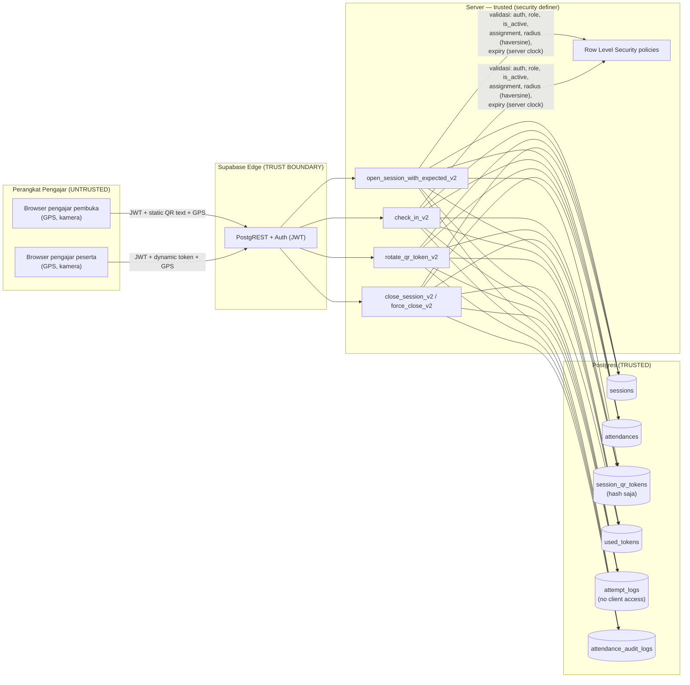

# Security E2E — Evaluation Report

**Suite:** `playwright.security.config.ts` (`e2e/security/`)
**Target:** hosted Supabase `aagmvgljdcrjtvhokhgm` — explicitly authorized by repo owner for this run (guard override `E2E_AUTHORIZED_HOST`, recorded in `.env.security`, gitignored).
**Branch:** `e2e/security-controls`
**Date:** 2026-10-31
**Migrations at HEAD:** 51 files, latest `20261029000000_add_attempt_logs.sql`
**Frontend:** vite preview :4173, production bundle of working tree (uncommitted UI redesign present)
**Final run:** 20/20 PASS (Playwright, 1 worker, no retries) + 11/11 guard unit tests (Vitest)
## 2b. R1 — Performance & concurrency probe (1/5/12 VU)

Script: `scripts/perf-vu-probe.ts` (tsx, single process, run-scoped `e2e-perf-*` fixtures, registry cleanup). Workload per VU: one `open_session_with_expected_v2`, then 3× `rotate_qr_token_v2` (the production hot path — QR rotates every 20 s per active session). Two TPA slots cap concurrent sessions at 2, matching the domain constraint (one active session per TPA).

**"Peak 12" definition (P0-02):** 12 concurrent authenticated clients dispatching session RPCs simultaneously from one host process. This measures server RPC throughput under concurrent client dispatch, NOT 12 distinct physical devices, network variance, or browser render cost.

Measured (2026-10-31, hosted target, two runs):

| VU | opens p50 | opens p95 | rotate p50 | rotate p95 | rotate fail |
|---|---|---|---|---|---|
| 1 | 311 / 191 ms | 311 / 191 ms | 101 / 183 ms | 101 / 233 ms | 0 |
| 5 | 325 / 231 ms | 337 / 233 ms | 101 / 105 ms | 127 / 124 ms | 0 |
| 12 | 543 / 194 ms | 640 / 337 ms | 95 / 97 ms | 101 / 132 ms | 0 |

Observation: no failures at any level; rotate latency flat (~100 ms p50); open p95 rises to ~640 ms at 12 VU in one run, ~337 ms in the other. Single-run variance is visible; treat these as order-of-magnitude observations, not SLA claims.

**Not measured / limitations:** browser render and QR decode cost on low-end phones; network jitter across real mobile networks; sessions beyond 2 concurrent (domain limit); sustained load beyond one burst per VU.

---

## 1. Verdict legend

| Status | Meaning |
|---|---|
| PASS | Playwright assertion passed AND DB evidence matched |
| OBSERVED_LIMITATION | Probe ran; behavior recorded as boundary, not a security PASS |
| FAIL | Assertion or invariant violated |
| BLOCKED | Could not execute |

## 2. Scenario matrix (SEC01–SEC12)

| ID | Scenario | Layer | Status | Evidence |
|---|---|---|---|---|
| SEC01 | Opening + legitimate check-in | UI + RPC + DB | PASS | 1 active session, opener auto-attendance exactly 1, joiner attendance exactly 1, expected list persisted; replay with new request-id rejected (`TOKEN_REUSED`/`ALREADY_CHECKED_IN`) |
| SEC02 | QR expired | RPC + DB | PASS | After 21 s (> 20 s TTL): `QR_INVALID_OR_EXPIRED`, 0 attendance rows, `attempt_logs` rejection row committed |
| SEC03a | Same-user re-scan, new request id | RPC + DB | PASS | Rejected (`TOKEN_REUSED`/`ALREADY_CHECKED_IN`), attendance count stays 1 |
| SEC03b | Forwarded token to *different* eligible user inside radius | RPC (exploratory) | OBSERVED_LIMITATION | Accepted by server — anti-forwarding boundary = geofence radius; see §4 |
| SEC04 | Cross-session token | RPC + DB | PASS | Token from session A on session B → `QR_INVALID_OR_EXPIRED` (hash mismatch), 0 writes |
| SEC05 | Outside radius | RPC + UI | PASS | Direct RPC: `OUTSIDE_RADIUS`, 0 rows. UI: no navigation to `/konfirmasi`. Server-side boundary proven, not client-only |
| SEC06 | Fabricated inside coordinates | RPC (exploratory) | OBSERVED_LIMITATION | Fabricated GPS inside radius accepted — geofence cannot distinguish real presence from spoofed coordinates |
| SEC07 | Two concurrent openers | RPC race + DB | PASS | Exactly 1 winner, loser `SESSION_ALREADY_ACTIVE`, 1 QR token row, 1 auto-attendance, loser attempt logged as rejected. Label: *concurrent client dispatch; server overlap unverified* |
| SEC08 | Non-opener closes | RPC + DB | PASS | `Hanya Pengajar Pertama…` raised; session still `is_active=true`, `date_closed=null` |
| SEC09 | Legitimate opener closes | UI + DB | PASS | UI closure → `is_active=false`, `close_notes` persisted, all attendances got `scan_out_time` + `checkout_method ∈ {manual, session_auto_close}` |
| SEC10 | QR forwarding | RPC (exploratory) | OBSERVED_LIMITATION | Outside: rejected (`OUTSIDE_RADIUS`). Inside: accepted → forwarding within radius undetectable |
| SEC11 | Unassigned / inactive | RPC | PASS | Inactive: `NOT_ELIGIBLE` at check-in. Unassigned: `NOT_ELIGIBLE` at open. 0 attendance rows |
| SEC12 | Closure variants | RPC | PASS | Blank notes rejected (`Materi TPA wajib diisi…`); NULL location + notes closes fine; admin force-close sets `[Admin force-close]` + `admin_force_close` checkout; non-admin force-close rejected |

## 3. Telemetry / ledger invariants

| Check | Status | Evidence |
|---|---|---|
| Same `request_id` replay → `REQUEST_ALREADY_PROCESSED`, no new log row | PASS | `attempt_logs` count unchanged before/after replay |
| Ordinary user cannot read `attempt_logs` | PASS | RLS blocks select (error, null data) |
| Ordinary user cannot write `attendances`/`sessions`/`used_tokens` directly | PASS | RLS blocks all three inserts |
| Rejection rows commit even when domain write rolled back | PASS | SEC02 rejection visible in `attempt_logs` via service-role observer |

## 4. Security findings (negative results are valid results)

1. **Geofence is the only anti-forwarding control (SEC03b/SEC10).** A dynamic QR token forwarded to *any eligible teacher* who is physically inside the radius is accepted. Token rotation (20 s TTL) narrows the window but does not close it. Boundary = `tpas.location.radius`.
2. **GPS spoofing unmitigated (SEC06).** Fabricated coordinates inside the radius are accepted; server has no second factor (no device attestation, no accuracy plausibility check beyond `LOCATION_INVALID` bounds). `location_accuracy_m` is recorded in `attendance_audit_logs` on close only.
3. **Token uniqueness is per-user, not per-token (SEC03a).** `used_tokens` PK `(user_id, session_id)`: one user cannot scan twice, but the same token can be consumed by multiple distinct users inside the TTL window.
4. **Race determinism (SEC07).** Winner/loser invariants hold under concurrent client dispatch. Server-side overlap could not be observed from the client; labeled INCONCLUSIVE for true serialization claims, though the DB invariants (single session, single token row) hold regardless.

## 5. Environment guard verification

`e2e/security/environment.test.ts` — 11/11 PASS (vitest, zero network):
production host rejected without `E2E_AUTHORIZED_HOST`; unknown hosted hosts rejected; local frontend/backend host mismatch rejected; missing/malformed marker rejected; credentials-in-URL rejected; missing service key rejected; fail-closed on unset `E2E_SECURITY_ENV`.

`globalSetup` additionally verifies: backend reachable with the supplied keys, frontend serving, and frontend bundle's Supabase URL matches `E2E_SUPABASE_URL`.

## 6. Reproduction

```bash
# env file (gitignored): .env.security with E2E_BASE_URL, E2E_SUPABASE_URL,
# E2E_SUPABASE_ANON_KEY, E2E_SUPABASE_SERVICE_ROLE_KEY, E2E_MARKER_HASH,
# E2E_AUTHORIZED_HOST (owner decision)
E2E_SECURITY_ENV=.env.security npx playwright test --config=playwright.security.config.ts
npx vitest run --config vitest.security.config.ts   # guard unit tests
```

## 7. Fixture hygiene

- Run-scoped namespace `e2e-sec-<runid>`: dedicated TPAs (`radius: 100`), synthetic accounts (5 + openerB), registry-tracked cleanup (audit logs → attendances → tokens → sessions → assignments → users → TPAs).
- No global deletes; no legacy session closure; production data untouched outside the run namespace.
- Auth-state/trace/video/screenshot capture OFF (JWT + QR payload leak risk). Report JSON contains structured results only.

## 8. Known constraints of this evidence

- Valid for this version (`e2e/security-controls` working tree), target, and date only.
- Browser geolocation emulation ≠ GNSS hardware validation.
- Concurrency: client-dispatch overlap only; server overlap unverified.
- Attempt telemetry counts only requests that reached and committed the instrumented RPCs.

---

## 9. Arsitektur dan trust boundary (R2)



**Trust boundaries:**

1. **Perangkat → Supabase**: semua input tidak dipercaya. Token QR, koordinat GPS, dan identitas hanya diverifikasi di server; klaim klien (jarak hitung `calculateDistance`, countdown expiry di payload QR) adalah UX saja, bukan kontrol keamanan — dibuktikan SEC05/SEC06.
2. **Anon/authenticated → domain tables**: RLS menolak tulis langsung; satu-satunya jalur tulis adalah RPC `security definer` (dibuktikan test "ordinary user cannot write domain tables").
3. **Klien → `attempt_logs`/`session_qr_tokens`/`used_tokens`**: tidak ada policy SELECT/INSERT → token mentah dan telemetri tidak pernah keluar dari server.
4. **Server → Postgres**: service-role hanya untuk provisioning/observer test; operasional harian memakai JWT aktor biasa.

## 10. Template detail deployment (P0-01) — untuk diisi pemilik

| Field | Nilai | Status |
|---|---|---|
| Tanggal mulai deployment operasional | _(isi: tanggal pertama sesi nyata lewat sistem)_ | ⬜ kosong |
| Tanggal akhir periode observasi | _(isi)_ | ⬜ kosong |
| Definisi "attempt" | Satu panggilan `open_session_with_expected_v2` / `check_in_v2` yang mencapai dan **commit** (termasuk penolakan terstruktur; tidak termasuk gagal jaringan/timeout/dekode QR lokal) | ✅ terdefinisi (docs/attempt-telemetry.md) |
| Definisi "failure" | Baris `attempt_logs` dengan `accepted = false` (outcome per kode: `OUTSIDE_RADIUS`, `QR_INVALID_OR_EXPIRED`, dst.) | ✅ terdefinisi |
| Definisi "peak 12" | 12 klien terautentikasi bersamaan dari satu proses host mengirim RPC sesi secara serentak (lihat §2b) — bukan 12 perangkat fisik | ✅ terdefinisi |
| Metode penghitungan peak | `max(count per menit)` pada `attempt_logs` dalam window observasi, atau angka dari probe VU | ⬜ pilih salah satu |

**Reported estimate dari admin (R1):** minta pengurus menjawab: *"Berapa lama waktu yang biasanya dibutuhkan untuk menyusun rekap bulanan sebelum memakai sistem, dan berapa setelah memakai sistem?"* — tulis jawabannya sebagai *reported estimate* (pernyataan pengguna, bukan pengukuran sistem), dengan tanggal wawancara.

## 11. Limitations yang harus ditulis di evaluasi (belum diukur)

- **Reliabilitas**: tidak ada pengukuran uptime/error-rate produksi jangka panjang.
- **Respons QR**: latensi rotasi end-to-end di perangkat nyata tidak diukur (probe mengukur RPC saja: ~100 ms p50 server-side).
- **Akurasi GPS**: emulasi geolocation browser ≠ akurasi GNSS perangkat nyata; tidak ada pengukuran akurasi di lapangan.
- **Durabilitas bukti**: laporan berlaku untuk versi, target, dan tanggal uji ini saja.
